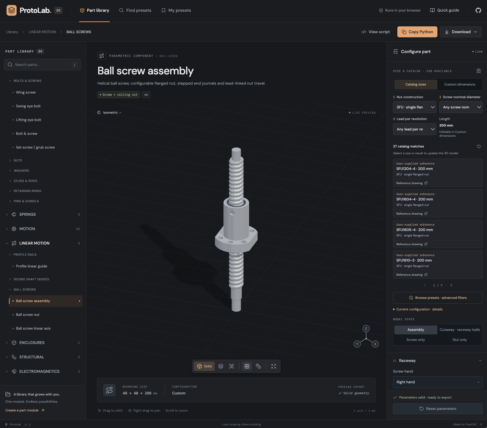

# ProtoLab 3D

A browser-based library of configurable mechanical products and assembly definitions. Find a component, adjust its dimensions, inspect its 3D preview, organize its physical occurrences in a design project, and bring the generated solid geometry into an existing FreeCAD document.



The application is a static React / TypeScript / Three.js site built with Vite. It runs without a backend and is suitable for GitHub Pages. The interface, generated Python, and source comments are in English.

## Run locally

Use Node.js 22 or later.

```sh
npm ci
npm run dev
```

Open the local URL printed by Vite. The default development port is `8080`, with the application at `http://localhost:8080/`.

```sh
npm run typecheck
npm test
npm run build
npm run preview
```

The production output is `dist/`. Vite uses `/` as the base for the custom domain `https://protolab.defencore.com/`, including JavaScript, styles and reference images. The GitHub Actions Pages workflow builds and uploads this directory; enable **Settings → Pages → Source → GitHub Actions** and set the custom domain in the repository. Deploying instead to a repository URL such as `https://defencore.github.io/ProtoLab-3D/` requires changing the Vite base to `/ProtoLab-3D/` before rebuilding.

## Working with parts

- Browse category → subgroup → component, or press `/` to search names, descriptions, keywords, and preset sizes.
- Choose a library view by engineering discipline, product type, make or buy policy, or manufacturing process. All views reference the same product definitions.
- Use **Catalog sizes** in the configurator for everyday selection. For bolts and screws, choose thread → length → head → drive. Each choice narrows the remaining catalog options and automatically selects a matching part in the 3D preview. Matching product cards, counts and supplier links remain beside the model; clicking a card applies it immediately.
- Switch to **Custom dimensions** to enter precise numeric dimensions and fine-tune the geometry.
- Open **Browse presets** for advanced searches by designation, standard, manufacturer, supplier SKU or source. Its sidebar keeps the model visible while you filter by category, part type, numeric ranges and shape choices. Clicking a result immediately updates the model and its parameter review.
- **Find matching** turns the current part's main dimensions and choices into editable search conditions. Remove individual conditions or widen their From/To ranges. Blank endpoints are unbounded, and both ends of a range are included. Browse all bearing types to compare available bore/outside diameter/width combinations.
- Choose a sourced catalog preset, a prototype example, or enter your own dimensions. Invalid configurations display an explanation and disable export.
- Open the single **Fasteners & threads → Spacers & standoffs** entry for all 4,451 choices: 4,444 supplier articles, four custom-order sleeve templates and three editable plain-spacer designs. Search `M3 10` or `M3 × 10 mm`, or choose ends, thread, body length, shape and material. **Catalog** lists actual supplier body lengths; **Range** accepts From/To bounds. Each length mode remembers its separate manual values. The first switch may initialize the alternate mode from a valid explicit exact length; it never uses the selected model or the lower endpoint of a genuine interval. **More filters** provides construction (including metal inserts), supplier, finish, independent end threads, overall length, diameter/across flats and plain bore. Options show counts under the other active filters; each filter can be cleared separately. Selecting an article preserves your filters and the real product identity. Results load in groups of 24.
- Each supplier card includes its product link. Choose **Custom-order sleeve** to request dimensions within DREMEC's published range; selecting a template applies your requested dimensions. The steel default reproduces printed example `324/2.1x10`; the other initial dimensions are customer examples. Missing source dimensions and conflicts remain identified in cards/specifications. DREMEC dimensions come from the manufacturer's 2020 catalog, with Ukrainian product-family links; current Ukrainian variations and stock are unconfirmed. See [source coverage and verification](docs/standoff-catalogs.md).
- Orbit, pan, and zoom the preview. Use the camera and rendering controls to inspect the model.
- Switch **Simple / Full** above the preview to hide or show declared thread detail. Simple is the default for lighter geometry and TechDraw; Full exports actual helical threads where the library defines a pitch and profile. Drawing callouts are retained in both modes. The mode is remembered in this browser and does not change product identity or configured dimensions.
- Where available, select an assembled/exploded bearing state or a free/loaded spring state. The selected state is used by every export.
- Save named presets in this browser. Presets use local storage and are not synced to another device.

**Copy for FreeCAD** puts a one-line `exec(...)` command on the clipboard. **FreeCAD options** lets you review the mode, copy the command or download the macro. Code and STL are prepared only when requested. In FreeCAD, open **View → Panels → Python console**, paste the command, and press Enter. The macro adds a single solid as a `Part::Feature`, or an assembly as an `App::Part` containing independently selectable component features. Expand the assembly in the model tree to hide components or change their **Placement**; moving the parent moves the complete assembly. The macro uses the active document, creates a document if necessary, and wraps creation in a transaction.

Preview and export workers load the selected product and its declared dependencies on demand. Project exports load the configured products and their dependencies. Unrelated model assets are not loaded into those workers.

The main application still loads the catalog at startup. Worker loading and Simple mode reduce subsequent geometry work; the initial catalog download remains large.

The download menu provides:

| Format                     | Result                                                                                                    |
| -------------------------- | --------------------------------------------------------------------------------------------------------- |
| FreeCAD macro (`.FCMacro`) | Standalone Python that constructs OpenCASCADE solid geometry in FreeCAD.                                  |
| STL (`.stl`)               | Binary triangle mesh in Simple mode, without thread relief, with coordinates in millimetres.              |
| Parameters (`.json`)       | Part ID, dimensions, model state, format version, and units. This is configuration data, not a CAD model. |

For STEP, run the macro in FreeCAD, select the created object, and use **File → Export**. Use **File → Save** for an FCStd document. The browser does not run the FreeCAD geometry kernel.

## Library and documentation

The library covers mechanical parts, fasteners, motion systems, actuators, electronics, power components, and vehicle structures. Use the category tree or search to select a part. The live library shows the current package count.

- [Library structure](docs/library-structure.md) and [library reference](docs/library-reference.md)
- [Source-dimensioned motion components](docs/motion-catalog.md): HIWIN guides, TBI screws and STEPPERONLINE motor sizes.
- [Tube drilling jigs with end stops, 4/8/12 hole belts and automatic guide selection](src/parts/tube-drill-jig/GUIDE.md)
- [Workshop jigs for drilling, routing, filing, indexing, bending and tube fitting](docs/workshop-jigs.md)
- [Product classification, specification sections and release requirements](docs/product-library.md)
- [Engineering projects, enterprise documentation rules and project CAD](docs/engineering-projects.md)
- [Part package contract and handoff](docs/part-modules.md)
- [Application architecture and build measurements](docs/architecture.md)
- [Catalog coverage](CATALOG_COVERAGE.md) and [engineering coverage](docs/engineering-library-coverage.md)
- [Geometry fidelity](docs/model-fidelity-audit.md) and [manufacturer CAD evidence](docs/manufacturer-cad.md)
- [Complete library macro verification and measured coverage](docs/library-script-audit.md)
- [Library filters, selection behavior and output verification](docs/library-filter-verification.md)
- [CAD handoff and drawing workflow](docs/recovery/README.md) and [TechDraw line settings](docs/freecad-techdraw.md)

Each package's `GUIDE.md` contains its specific sources, dimensions, and limitations. READMEs describe workflows shared across the project or package system.

## Independent part packages

Each product family lives in one folder under `src/parts/<part-id>/`. That folder contains its classification, configurator, presets, preview, FreeCAD recipe, validation and component-specific helpers. Shared hardware and geometry have one implementation in the documented SDK. Assemblies declare their library dependencies; portable handoffs include the complete dependency closure and run in an isolated workbench.

```text
src/
  App.tsx                       Application state and commands
  components/                   Generic controls, views and React state hooks
    usePresetBrowser.ts         Memoized catalog results, facets and navigation
    requestWorkerOutput.ts      Shared preview/export worker lifecycle
  core/
    types.ts                    Parameter and PartDefinition contracts
    product-types.ts            Product, occurrence and design-project contracts
    product-library.ts          Classification, grouping and specification sections
    design-project.ts           Product structure, manufacturing, procurement and release checks
    part-modules.ts             Versioned package contract and validation
    preset-browser.ts           Scope changes, field presentation and result pagination
    preset-resolution.ts        Source identity and explicit supplier selection
    assembly/                   Shared physical geometry and library instance rendering
    hardware/                   Shared fastener, nut, washer, bearing, gear and spring utilities
    component-recipes.ts         Structured local fabrication geometry and component definitions
    geometry.ts                 Generic mesh primitives
    mechanical.ts               Generic boundary meshes and section construction
    manufacturer-cad.ts         Compressed supplier meshes, placements and native BREP export
    solid-union.ts              Generic mesh boolean operations
    freecad.ts                  Application export wrapper
  parts/
    index.ts                    Generated registry; do not edit manually
    <part-id>/
      index.ts                  Package API version, stable ID, display order and library dependencies
      part.ts                   Definition, geometry, FreeCAD recipe and validation
      configurator.ts           Local configuration metadata
      presets.json              Complete local preset snapshot and source evidence
      product.json              Product type, supply, manufacturing routes and release requirements
      lib/                      Private domain helpers, when needed
      README.md                 Shared package workflow
      GUIDE.md                  Component-specific scope and sources
  catalog/                      Offline supplier inputs and refresh adapters
scripts/
  build/                        Native CAD asset handling and startup dependency report
  parts.ts                      Create, check, export, import and registry tools
  sync-package-catalogs.ts       Explicit offline supplier-to-package refresh
```

The migrated packages define their numeric and conditional parameter schema in `part.ts` or a private factory under `lib/`; their `configurator.ts` defines ordered **Catalog sizes** selectors. The new-part template separates its parameter schema and defaults into `configurator.ts`. Both layouts keep all editable part behavior in the same package. Its README explains the shared workflow; GUIDE.md records component-specific details.

Reusable thread, bearing, spring and gear helpers belong to the shared SDK. Unique component geometry and reference data remain local. Imports into another product package require an explicit library dependency, and dependency cycles are rejected. The boundary checker rejects undeclared package imports and application catalog imports. `src/catalog` remains an offline data preparation layer; the browser uses each package's `presets.json`.

Vite discovers added or removed package folders and regenerates the registry. Existing-file edits update the live preview and configurator through hot reload. The application resolves the selected module by ID, applies updated untouched defaults and preserves compatible edits. Removed fields, unsupported values and removed states are reconciled against the new definition. A part's `defaultSelection: true` metadata chooses the initial selection; only one package may declare it.

See [the part package guide](docs/part-modules.md) for the contract, editing workflow, examples, source metadata and handoff details.

## Refreshing supplier presets

Replace `<part-id>` and `<output-folder>` in the examples with actual values.

Run the import scripts explicitly when a new offline snapshot is needed. They read public catalog pages and do not interact with carts or accounts. Cached pages allow interrupted imports to resume.

```sh
python3 scripts/import-gvyntok-fasteners.py
python3 scripts/import-gvyntok-hardware.py gajki
python3 scripts/import-gvyntok-hardware.py shajby-koltsa
python3 scripts/import-gvyntok-hardware.py shpilki
python3 scripts/import-gvyntok-hardware.py shplinty-i-strubtsiny
python3 scripts/build-hardware-presets.py
python3 scripts/build-cotter-presets.py
python3 scripts/import-promtehimport.py --workers 2
node --import tsx scripts/build-promtehimport-presets.ts
node --import tsx scripts/sync-package-catalogs.ts <part-id> --check
node --import tsx scripts/sync-package-catalogs.ts <part-id>
node --import tsx scripts/report-catalog.ts
```

The final sync is explicit and scoped to one part. Use `--all --check` to review every package, then `--all` to refresh all supported supplier snapshots. `--check` makes no changes and exits with status 1 when updates are pending. The sync reads existing offline adapter outputs; it never crawls websites. It validates the resulting presets before writing, preserves examples and unrelated sources, and backs up changed snapshots outside `src/parts`. Refreshing upstream catalog inputs alone does not overwrite an independently edited part package. See [catalog refresh behavior](docs/part-modules.md#refreshing-catalog-snapshots).

Review coverage and any source conflicts before accepting refreshed data. The hardware builder transcribes the linked supplier drawings and preserves nominal versus clearance diameters. Models do not infer missing envelope dimensions from price, names or nearby products.

## Adding a part

Create a complete starter package:

```sh
npm run parts:create -- <part-id> --name "Display name"
npm run parts:check -- <part-id>
npm run dev
```

The template starts with a working spacer, so its preview and FreeCAD export can be tested immediately. Change its schema, geometry, labels and categories in `src/parts/<part-id>/`. The package ID stays stable; folder discovery updates the generated registry automatically.

Export an existing part, including the local code, SDK and referenced drawings, to a new folder outside `src/parts`:

```sh
npm run parts:export -- <part-id> <output-folder>
```

The recipient runs `npm install`, `npm run dev` and `npm run build` in that handoff folder. Its workbench shows the part's own controls, presets, states, 3D geometry and generated FreeCAD macro. Return the complete handoff folder with `part-module.json` intact, then import it into the main project:

```sh
npm run parts:import -- <output-folder> --replace
npm run parts:check -- <part-id>
npm run typecheck
npm run build
```

Import replaces only the selected package and keeps its previous version under `.part-module-backups/`. SDK and workbench edits are not imported into the application. Omit `--replace` for a new part ID. Shared reference assets are never silently overwritten: an edited drawing needs a unique filename. No UI changes or manual registry edits are needed.

## Geometry and manufacturing scope

Models record whether their geometry comes from manufacturer CAD, sourced dimensions, an envelope, or a parametric design. Check the selected component's evidence and guide before using it. Solid validity and collision checks do not establish manufacturing tolerances, structural suitability, or product compatibility.

FreeCAD exports create static solids and configuration metadata. Change parameters in ProtoLab and regenerate when a different configuration is needed. Assembly solids can be selected and moved independently; STL exports contain tessellated preview geometry. See the [geometry scope reference](docs/library-reference.md#geometry-scope) for family-specific limits.

## Verification

`npm run parts:check -- <part-id>` checks a single package boundary, API, schema, defaults and preset parameters. `npm run parts:check` checks the complete library. `npm test` runs offline catalog, geometry, export, and validation checks, without requiring a FreeCAD installation. `python3 -m unittest discover -s tests -p 'test_*.py'` checks the Python catalog importers. `npm run typecheck` and `npm run build` verify the TypeScript application and production bundle.

The generated recipes are also checked with a local FreeCAD runtime during development. Checks include validity, positive solid volume and agreement with preview dimensions. Gear checks include all defaults/presets; fastener checks exercise head, drive, thread and point variants; spring checks exercise presets, states and end profiles. Runtime checks establish that the recipes execute and produce the intended geometry; they do not establish engineering suitability or exact manufacturer internals. In-memory shape checks do not add objects to user documents. Full macro checks use a temporary document and restore the previously active document.

GitHub Pages deployment follows the [official custom workflow documentation](https://docs.github.com/en/pages/getting-started-with-github-pages/using-custom-workflows-with-github-pages). Push to `main` after enabling the GitHub Actions Pages source to publish. Pull requests run tests and builds without deploying.

### Reusing successful CI verification

Every workflow run installs locked dependencies, checks TypeScript and test contracts, validates all part packages and presets, runs the Python importer tests, and builds the production site. Eight parallel geometry jobs then run the complete test suite using Node's test-file sharding. The per-part contracts are distributed across `tests/parts-catalog-*.test.ts` so one large catalog file cannot serialize most of the workload. Deployment requires the build and every geometry job to succeed.

Each geometry shard is reused only when an exact successful result exists for the same test inputs, shard index/count and Node runtime. `scripts/ci-test-key.mjs` hashes tracked file paths and contents under `src/`, `tests/`, `scripts/`, `data/`, `public/` and `.github/workflows/`, plus the package manifests and root TypeScript configurations. The key also includes the exact Node version, operating system and architecture. Changes, additions, removals and renames invalidate every shard's result. Add any future test inputs outside these paths to the fingerprint contract.

Deployment-only files (`vite.config.ts`, `index.html`, `CNAME`) and documentation outside those directories do not invalidate geometry results; their build and TypeScript checks still run. UI source changes conservatively invalidate the full suite too. A cache miss or eviction executes that shard's tests. There are no partial-key matches, failed shards never write a success marker, and pull requests can consume the main branch cache but cannot publish one. Failures are published as check annotations and per-shard log artifacts; other shards continue to report their results.

The first run after introducing this cache must finish every shard once. Later deploys with unchanged inputs reuse those successful results. A newer push queues behind a running workflow instead of cancelling its tests and starting from zero; GitHub retains only the newest pending run for that branch. Local `npm test` always runs the complete suite. To force fresh verification in GitHub, choose **Actions → Build and deploy GitHub Pages → Run workflow → full_tests**. Each job summary says whether its tests executed or an exact successful result was reused.

### Mechanism and control audit

`npm run audit:parameters -- /tmp/parameter-audit.json` checks visible controls through their actual update functions across construction families and inspection states. Unchanged native recipes are review candidates: reference values, material choices and equal-envelope catalog products may legitimately share geometry. See the [mechanism audit and native CAD results](docs/mechanism-audit.md) for corrected mechanisms, catalog-first selection and explicit modeling limits. Full tests use at most two concurrent files to limit memory pressure.

### Geometry evidence

Each configuration shows whether it uses manufacturer CAD, a reconstruction from source dimensions, an envelope, or a parametric design. The same evidence is preserved in FreeCAD exports. Source-linked dimensions do not certify every surface or internal component. See the [whole-library fidelity audit](docs/model-fidelity-audit.md) and [manufacturer CAD revisions and limitations](docs/manufacturer-cad.md). Regenerate coverage with `npm run audit:models`.

## Repository conventions

Write documentation, instructions, comments, and interface text in English. Repository text and file names must not contain literal Cyrillic characters. Supplier snapshots and foreign-input parser fixtures preserve exact source strings through Unicode escapes; they are machine evidence, not translated instructions or interface text.

Run `npm run check:language` before publishing. CI checks repository text and file names, including README scope. Keep README files universal; put component-specific engineering details in separate guides. Follow the [library naming conventions](docs/library-naming.md) for part labels and model identifiers.
